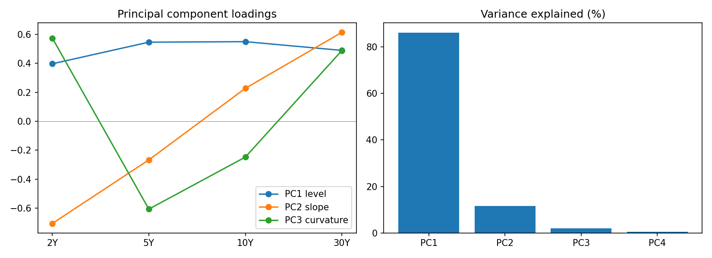
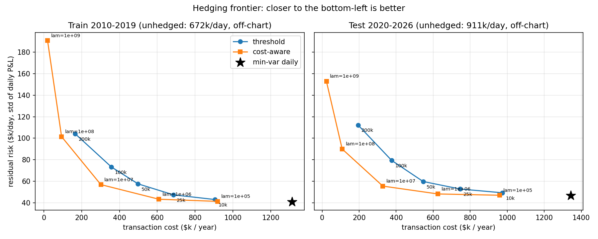
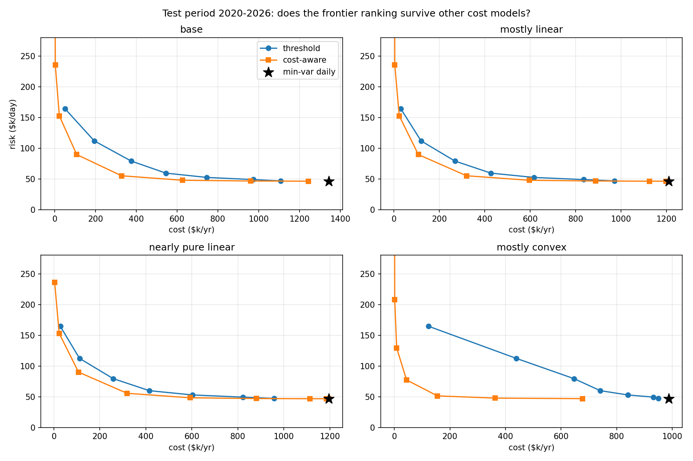

# Cost-aware hedging of a rates portfolio: a backtest on Treasury yield data

**Question:** a fund holds interest-rate risk and hedges it with futures. Every hedge trade costs money. How often, and how tightly, should it hedge to get the most risk reduction per dollar of trading cost?

**Short answer (under the cost model below):** a cost-aware optimiser keeps about **97.5% (train) and 99.0% (test) of the volatility reduction of a daily minimum-variance hedge, at about 23-24% of its trading cost**, and it beats a simple threshold rule at matched risk across four different cost structures.

This is an illustrative research project. The market data is real; the portfolio and the transaction costs are assumptions (see Limitations).

## Data

- FRED constant-maturity Treasury yields: DGS2, DGS5, DGS10, DGS30.
- Common sample 2010-01-04 to 2026-10-29: 4,208 daily changes, in basis points. Holidays (missing values) are dropped.
- Train period 2010-2019, test period 2020-2026. The test period includes the 2022-23 hiking cycle.

### The curve has a few dominant factors

PCA on daily yield changes: **86.0% level, 11.6% slope, 2.0% curvature, 0.5% residual**. The loadings have the classic shapes (see `results/pca.png`).



### Volatility is not constant

Daily 2Y volatility was roughly 1.5-4.5 bp a day through the 2010s, then **8.0 bp in 2022 and 9.6 bp in 2023** (`results/vol_regimes.png`). A covariance matrix fitted on the 2010s would badly understate risk in the test period, so the backtest uses an EWMA covariance (decay 0.94) that adapts.

## Method

- **Book:** synthetic DV01 in four buckets (2Y, 5Y, 10Y, 30Y), mean $20k/$40k/$60k/$30k per bp, simulated as a mean-reverting process in logs so it stays positive. Daily P&L is `-(DV01 x yield change)`, using the DV01 held at the previous close.
- **Hedge instruments:** 2Y, 5Y and 10Y futures only. With no 30Y future, the 30Y exposure is hedged only through correlation, so some risk always remains.
- **Timing, no look-ahead:** the hedge is decided at the close of day t-1 using only data up to t-1, and day t's curve move produces the P&L. Covariance is estimated only from past data.
- **Policies:**
  1. *No hedge.*
  2. *Min-var daily:* rebalance every day to the minimum-variance hedge, ignoring cost.
  3. *Threshold:* rebalance to the min-var hedge only if doing so would remove more than a set amount of daily risk.
  4. *Cost-aware:* each day solve `minimise  r' S r + lambda * dq' C dq`, where `r` is the residual DV01, `S` the covariance, and `C` the quadratic trading-cost matrix. Closed form; `lambda` is swept.
- **Cost model (assumed, not observed):** trading cost = `0.5 x DV01 traded + 1e-5 x (DV01 traded)^2`, charged per instrument. The first day's hedge, which builds the whole position, is included in every policy's cost.
- **Selecting settings:** lambda and the threshold are read off the train period and judged on the test period.

## Results

Risk is the standard deviation of daily P&L before costs. Cost is in dollars per year.

**Test period 2020-2026**

| Policy | Risk ($k/day) | Cost ($k/yr) |
|---|---|---|
| No hedge | 910.8 | 0 |
| Min-var daily | 46.7 | 1,344.0 |
| Threshold 50k | 59.8 | 545.4 |
| Threshold 100k | 79.4 | 375.5 |
| **Cost-aware, lambda = 1e7** | **55.5** | **328.0** |
| Cost-aware, lambda = 1e8 | 90.0 | 108.2 |

**Train period 2010-2019**

| Policy | Risk ($k/day) | Cost ($k/yr) |
|---|---|---|
| No hedge | 672.2 | 0 |
| Min-var daily | 40.8 | 1,312.4 |
| Threshold 50k | 57.6 | 498.0 |
| Threshold 100k | 73.3 | 357.1 |
| **Cost-aware, lambda = 1e7** | **56.9** | **301.5** |
| Cost-aware, lambda = 1e8 | 101.5 | 93.9 |



Hedging cuts daily P&L volatility by about 94-95% (the remainder is mostly the unhedged 30Y exposure). The cost-aware policy at lambda = 1e7, chosen on the train period, removes 615k of the 631k that min-var removes in train and 855k of 864k in test, while paying about a quarter of the cost.

### Robustness to the cost model

The cost-aware policy's advantage depends on the cost structure, so I re-ran the comparison with different mixes of linear (spread) and convex (impact) costs. The table shows the average cost saving of cost-aware versus threshold at the same risk level (7 comparison points per row).

| Cost structure | Saving, train | Saving, test |
|---|---|---|
| Base | 37.6% | 45.1% |
| Mostly linear (impact x 0.1) | 19.7% | 30.1% |
| Nearly pure linear (impact x 0.01) | 16.9% | 27.8% |
| Mostly convex (spread x 0.2, impact x 5) | 76.8% | 80.3% |

The advantage is largest when impact costs dominate, because the threshold rule trades the whole gap at once and convex costs punish lumpy trades. It shrinks, but stays positive, as costs become linear.



## Limitations

- **Costs are assumptions.** They are illustrative, not market-observed. The conclusions hold under the structures tested, not in general.
- **The portfolio is synthetic.** A fund's real book isn't public. Results use one simulated book path (seed 42); they are not averaged over many.
- **Treasury yields stand in for swap rates.** Long SOFR swap history isn't freely available.
- **No carry or roll-down.** The unhedged P&L is pure mark-to-market, so the long slide after 2022 would be partly offset by income in practice.
- **Linear DV01 only.** No convexity.
- **Continuous contracts.** No rounding to whole contracts.
- **The optimiser only sees the quadratic part of the cost.** The linear spread is charged in the backtest but not optimised for.
- **The threshold rule is crude.** It rebalances all the way to the target. A proper no-trade band that trades only to the band edge might do better, particularly under linear costs, so the comparison is against this specific implementation.

## Possible extensions

- Proper no-trade band policy (solve with `cvxpy` including an L1 spread term).
- EWMA versus a static covariance fitted on the train period, to quantify the cost of ignoring regimes.
- Average over many simulated books; add a 30Y future and measure how much residual risk it removes.

## Reproduce

```bash
python3 -m venv .venv && source .venv/bin/activate
pip install -r requirements.txt
# data/fredgraph.csv from:
# https://fred.stlouisfed.org/graph/fredgraph.csv?id=DGS2,DGS5,DGS10,DGS30&cosd=2010-01-01

python -m src.data              # data checks
python -m src.pca_report        # PCA + volatility by year
python -m src.unhedged_report   # unhedged P&L of the synthetic book
python -m src.run_backtest      # policies, train/test tables
python -m src.plot_frontier     # frontier chart
python -m src.cost_sensitivity  # cost-model robustness
```

## Layout

```
src/data.py            load FRED yields
src/changes.py         daily changes in bp
src/portfolio.py       synthetic book, hedge matrix, unhedged P&L
src/backtest.py        EWMA covariance, policies, cost model, backtest loop
src/run_backtest.py    train/test summary tables
src/plot_frontier.py   frontier chart
src/cost_sensitivity.py  robustness to cost structure
results/               charts and CSV summaries
```